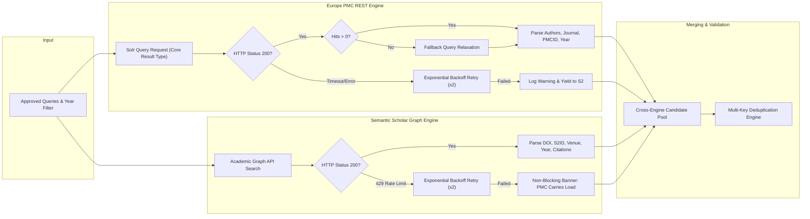
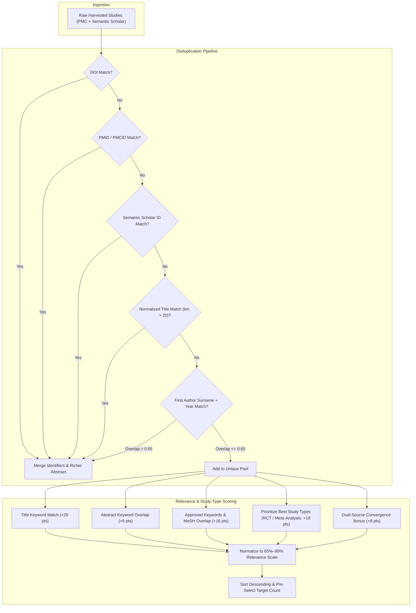

# Preppt – Scientific Literature to Presentation

[](https://preppt-ai.vercel.app)
[](https://github.com/roroleaks/Preppt)
[](https://nodejs.org/)
[](https://europepmc.org/)
[](https://www.semanticscholar.org/)
[](https://github.com/doxov/docx)
[](LICENSE)

**Preppt** is an evidence-based clinical and scientific presentation generator. It systematically harvests biomedical literature from **Europe PMC / PubMed Central** and **Semantic Scholar**, applies multi-key deduplication and semantic relevance ranking, guides the clinician through rigorous interactive approval gates, and produces a publication-grade, 11-part Microsoft Word (`.docx`) presentation specification.

🔗 **Live Production Application**: [https://preppt-ai.vercel.app](https://preppt-ai.vercel.app)  
📦 **GitHub Repository**: [https://github.com/roroleaks/Preppt](https://github.com/roroleaks/Preppt)

---

## 🌟 Key Capabilities & Architectural Principles

- **Dual-Engine Harvesting**: Concurrently queries Europe PMC REST API and the Semantic Scholar Academic Graph with automatic retries and resilient fallback if one upstream source is rate-limited or temporarily unavailable.
- **Three Mandatory Human Approval Gates**:
  1. *Keyword Approval Gate*: Clinicians review and refine suggested primary terms, clinical synonyms, and MeSH concepts.
  2. *Search Strategy Approval Gate*: Dual Solr/Graph queries are inspectable and editable before issuing network requests.
  3. *Selected Papers Approval Gate*: Curated evidence papers must be explicitly approved before slide synthesis begins.
- **Audience & Density Adaptation**: Calibrates medical terminology depth across 5 audience tiers (*Public audience, Undergraduate, Postgraduate, Consultants, Mixed audience*) and visible slide text across 3 density tiers (*Detailed, Balanced [30–40% occupancy], Short bullet points*).
- **10 Mandatory Slide Fields**: Every synthesized slide contains all 10 essential specification fields, including slide objective, main message, visual type suggestion, detailed visual description, verbatim speaker notes narration script, interactive audience question, and logical transition.
- **Strict Citation Isolation**: Zero in-text citations or references on slide cards. All bibliographic citations are strictly consolidated in a dedicated, Vancouver-style final References section.
- **Pre-Export Integrity Gate (Prompt 13)**: Automatically audits 9 compliance criteria before allowing Word document export.
- **Single Active Run Model**: Focused workflow with zero database overhead, session pollution, or cloud dependency.

---

## 🔄 System Architecture & Mechanisms

### 1. End-to-End Workflow Pipeline

```mermaid
flowchart TD
  subgraph Step1 ["Step 1: Input Parameters"]
    A["User Inputs Topic & Short Title"] --> B["Select Target Count, Year, Audience, Slides, Density"]
    B --> C{"Input Validation Passed?"}
    C -- No --> B
  end

  subgraph Step2 ["Step 2: Keyword Proposal"]
    C -- Yes --> D["AI Heuristic Domain Engine"]
    D --> E["Generate Primary Terms, Synonyms & MeSH"]
    E --> F["Interactive Keyword Editor"]
    F --> G[["Gate 1: Approve Keywords Button"]]
  end

  subgraph Step3 ["Step 3: Search Strategy Formulation"]
    G --> H["Formulate Europe PMC Solr Query"]
    G --> I["Formulate Semantic Scholar Query"]
    H --> J["Review & Edit Dual Query Box"]
    I --> J
    J --> K[["Gate 2: Approve Search Strategy Button"]]
  end

  subgraph Step45 ["Step 4 & 5: Retrieval & Ranking"]
    K --> L["Concurrent API Dispatch with Auto-Retry"]
    L --> M["Multi-Key Deduplication (DOI, PMID, S2ID, Title)"]
    M --> N["Multi-Factor Relevance & Best Study-Type Ranking"]
  end

  subgraph Step6 ["Step 6: Paper Review Screen"]
    N --> O["Card Review with Metrics & Links"]
    O --> P["Actions: Keep, Essential, Background, Note, Remove"]
    P --> Q{"Selected Papers >= 1?"}
    Q -- No --> P
    Q -- Yes --> R[["Gate 3: Approve Selected Papers Button"]]
  end

  subgraph Step78 ["Step 7 & 8: Presentation Deck Studio"]
    R --> S["Evidence-Based Synthesis Plan & Research Gaps"]
    S --> T["Generate N Slides with All 10 Required Fields"]
    T --> U["Audience & Density Calibration"]
  end

  subgraph Step910 ["Step 9 & 10: Validation & Word Export"]
    U --> V{"Gate 4: Pre-Export Integrity Audit (9 Checks)"}
    V -- Fails --> W["Display Validation Issues & Block Export"]
    V -- Passes --> X["Compile 11-Part Document via docx Library"]
    X --> Y[["Download Word Document (.docx)"]]
  end
```



---

### 2. Dual-Engine Retrieval & Resilience Architecture



---

### 3. Multi-Key Deduplication & Relevance Ranking



---

### 4. Word Document Layout Architecture (11-Part Sequence)

The exported `.docx` document adheres strictly to the **word-document-styling** design system:

```mermaid
flowchart TD
  subgraph Section_Order ["Strict 11-Part Sequence"]
    P1["1. Cover Page & Educational Disclaimer Box"] --> P2["2. Project Information & Metadata Table"]
    P2 --> P3["3. Topic & Short Presentation Title"]
    P3 --> P4["4. Audience & Slide Specifications Table"]
    P4 --> P5["5. Approved Keywords List (Primary, Synonyms, MeSH)"]
    P5 --> P6["6. Approved Search Strategy Table (PMC & S2 Queries)"]
    P6 --> P7["7. Selected Papers Table (PMID, DOI, Journal, Year, Source)"]
    P7 --> P8["8. Research Gaps & Unresolved Questions (Established vs Uncertain)"]
    P8 --> P9["9. Presentation Structure Outline"]
    P9 --> P10["10. Full Slide-by-Slide Content (10 Fields per Slide)"]
    P10 --> P11["11. References Section (Complete Vancouver Citations [1..N])"]
  end
```



---

## 📋 The 10 Mandatory Fields per Slide

Every synthesized slide card is rendered in a clean, high-contrast visual table containing:

| # | Field Name | Description |
| :-: | :--- | :--- |
| **1** | **Slide Number** | Sequential number (`SLIDE 1` to `SLIDE N`). |
| **2** | **Slide Title** | Clear, authoritative title reflecting the slide's specific clinical domain. |
| **3** | **Slide Objective** | Single actionable sentence defining the learning or clinical outcome. |
| **4** | **Main Message** | High-yield clinical takeaway summarizing the key evidence. |
| **5** | **On-Slide Text** | Formatted bullet points calibrated for 16:9 layout (occupancy 30–40%). |
| **6** | **Suggested Visual Type** | Specific diagram recommendation (e.g. *Forest plot*, *Consort diagram*, *Timeline*, *Pathophysiologic flowchart*). |
| **7** | **Detailed Visual Description** | Exact description of boxes, arrows, labels, axes, and color schemes. |
| **8** | **Speaker Notes** | Verbatim spoken script in shaded card for presenter pacing (~1.5 min/slide). |
| **9** | **Interactive Audience Question**| Thought-provoking clinical question to engage participants. |
| **10**| **Logical Transition** | Smooth transition bridging the current slide to the next topic. |

---

## 🛡️ Pre-Export Integrity Audit (Prompt 13)

Before enabling the `Export to Word` button, the system verifies all 9 criteria:

1. **English-Only**: Complete text, titles, notes, and visual descriptions are in English.
2. **Slide Count Match**: Synthesized count matches user request exactly ($N = N_{\text{requested}}$).
3. **10 Fields Present**: All 10 mandatory fields are non-empty across every slide.
4. **References Isolated**: References appear exclusively in Section 11; zero citations below individual slides.
5. **No In-Text Citations**: Zero bracketed numbers `[1]` or author-year tags in on-slide text or notes.
6. **Removed Papers Excluded**: Studies removed during review are permanently excluded from active selection.
7. **No Copied Content**: Zero legacy project text or unrelated topic contamination.
8. **Project Name Intact**: Verified identity: `Preppt – Scientific Literature to Presentation`.
9. **Secrets Guarded**: Zero API tokens, private keys, or bearer credentials exposed in payloads or document text.

---

## 🚀 Getting Started

### Prerequisites
- [Node.js](https://nodejs.org/) v18.0.0 or higher
- Windows 10/11 or macOS/Linux

### Installation & Launch
```bash
# Clone the repository
git clone https://github.com/roroleaks/Preppt.git
cd Preppt

# Install dependencies (docx library)
npm install

# Start the local server
node server.js
```

Open your browser and navigate to:
```
http://localhost:3080
```

### Running Automated Test Suites
```bash
# Run comprehensive end-to-end regression tests (12 suites)
node test-e2e.js

# Run live scenario integration test with deep Word document XML inspection
node scratch/run-random-topic-e2e.js
```

---

## 📄 License & Attribution

- **Author**: Dr. Raouf Roshdy
- **Copyright**: `copyrights@Raouf Roshdy2025`
- **License**: [MIT](LICENSE)
- **Educational Disclaimer**: This software and generated presentation specifications are intended solely for educational and presentation-planning purposes. They do not replace critical appraisal of original biomedical literature or professional clinical judgment.
