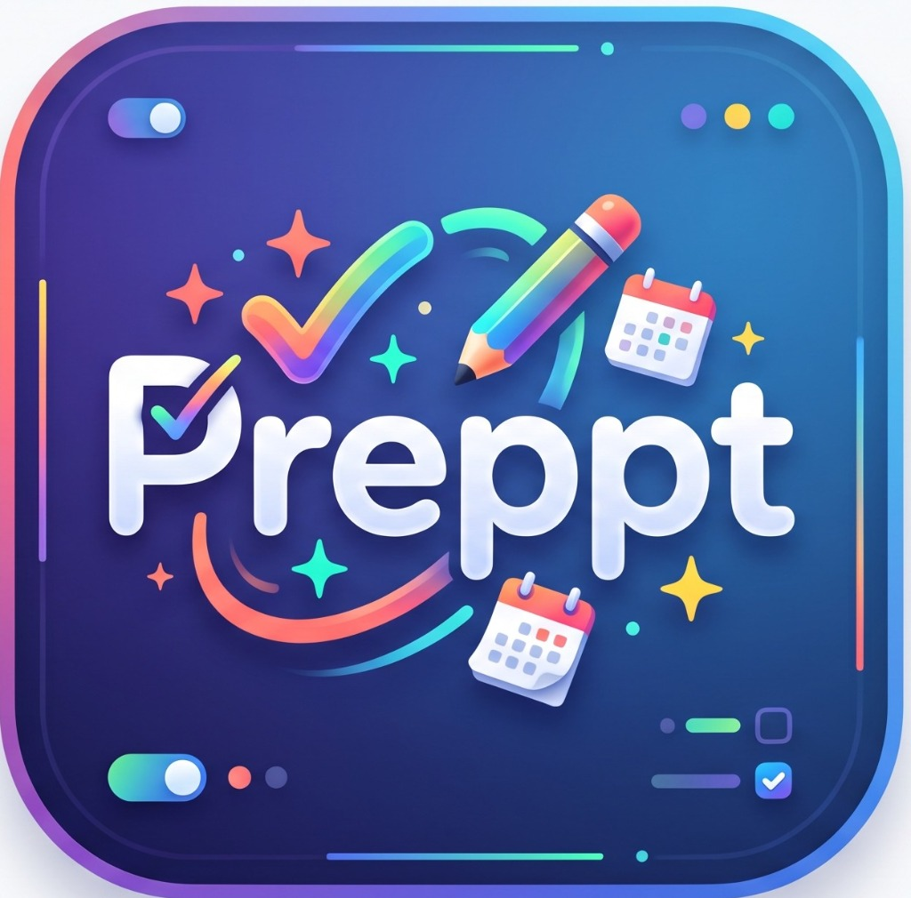
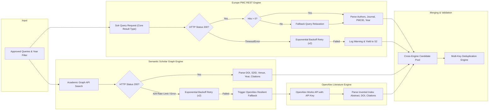
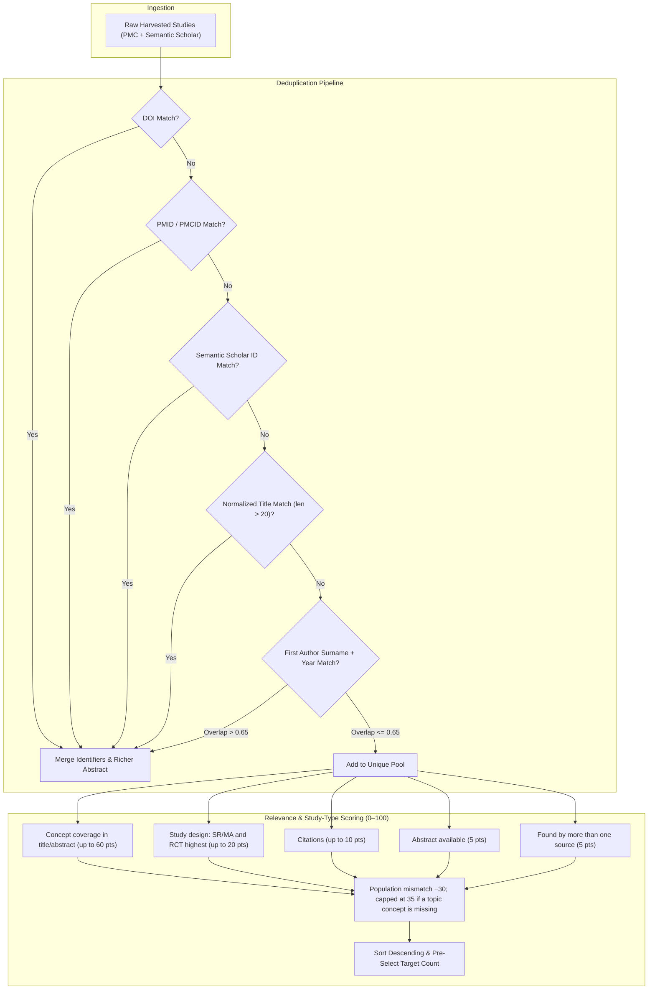

<div align="center">

<p align="center">
  
</p>

# Preppt – Scientific Literature to Presentation

[](https://preppt-ai.vercel.app)
[](https://github.com/roroleaks/Preppt)
[](https://nodejs.org/)
[](https://europepmc.org/)
[](https://www.semanticscholar.org/)
[](https://openalex.org/)
[](https://github.com/doxov/docx)
[](LICENSE)

</div>

**Preppt** is an evidence-based clinical and scientific presentation generator. It systematically harvests biomedical literature from **Europe PMC / PubMed Central** and **Semantic Scholar** (with automated **OpenAlex** and **Crossref** fallbacks), applies multi-key deduplication and transparent rule-based relevance ranking, guides the clinician through interactive approval gates, and produces an 11-part Microsoft Word (`.docx`) presentation **specification** (slide text, speaker notes and visual descriptions for each slide).

> **What Preppt does and does not do.** Keywords, ranking, findings and conclusions are extracted from the selected abstracts by deterministic rules — no language model writes the slide content. The output is a Word document that specifies each slide; Preppt does **not** produce PowerPoint (`.pptx`) files or rendered slides. Findings come from abstracts only, so always check them against the full papers.

🔗 **Live Production Application**: [https://preppt-ai.vercel.app](https://preppt-ai.vercel.app)  
📦 **GitHub Repository**: [https://github.com/roroleaks/Preppt](https://github.com/roroleaks/Preppt)

---

## 🌟 Key Capabilities & Architectural Principles

- **Dual-Engine Harvesting**: Concurrently queries Europe PMC REST API and the Semantic Scholar Academic Graph with automatic retries and resilient fallback if one upstream source is rate-limited or temporarily unavailable.
- **Three Mandatory Human Approval Gates**:
  1. *Keyword Approval Gate*: Clinicians review and refine suggested primary terms, clinical synonyms, and MeSH concepts.
  2. *Search Strategy Approval Gate*: Dual Solr/Graph queries are inspectable and editable before issuing network requests.
  3. *Selected Papers Approval Gate*: Curated evidence papers must be explicitly approved before slide synthesis begins.
- **Audience & Density Adaptation**: Calibrates medical terminology depth across 5 audience tiers (*Public audience, Undergraduate, Postgraduate, Consultants, Mixed audience*) and visible slide text across 3 density tiers (*Detailed, Balanced [30–40% occupancy], Short bullet points [8-word target for non-finding bullets; up to 18 words for finding bullets so labelled numbers and confidence intervals stay intact]*).
- **10 Mandatory Slide Fields**: Every synthesized slide contains all 10 essential specification fields, including slide objective, main message, visual type suggestion, detailed visual description, verbatim speaker notes narration script, interactive audience question, and logical transition.
- **Strict Citation Isolation**: Zero in-text citations or references on slide cards. All bibliographic citations are strictly consolidated in a dedicated, Vancouver-style final References section.
- **Rule-Based Keyword Engine**: Concept phrases are taken from the topic and matched against a curated vocabulary on whole words; no invented synonyms or generic MeSH headings. Each concept becomes an ANDed `TITLE_ABS` group in the Europe PMC query, with a separate arm for randomised trials, systematic reviews and meta-analyses.
- **Study-Design Classification**: Uses publication-type metadata first, then title, then abstract (systematic review / meta-analysis before RCT; protocols, guidelines and retrospective studies recognised). Shared by browser and server (`public/evidence-rules.js`).
- **Evidence Verdict**: The overall direction (benefit / mixed / no benefit / harm / insufficient) is weighted by study design and driven by primary-endpoint sentences; subgroup, secondary and off-population results cannot flip the conclusion.
- **Pre-Export Integrity Gate**: Automatically runs 25 checks before allowing Word document export (see below).
- **API Protection**: `/api/*` proxies accept browser requests only from the app's own origins, are rate-limited per IP, cap request bodies at 3 MB, and never forward client-supplied API keys.
- **Single Active Run Model**: Focused workflow with zero database overhead, session pollution, or cloud dependency.

---

## 🔄 System Architecture & Mechanisms

### 1. End-to-End Workflow Pipeline

```mermaid
flowchart TD
  subgraph Step1 ["Step 1: Input Parameters"]
    A["User Inputs Topic & Short Title"] --> B["Select Target Count, Year, Audience, Slides, Density"]
    B --> C{"Input Validation Passed?"}
    C -- No --> B
  end

  subgraph Step2 ["Step 2: Keyword Proposal"]
    C -- Yes --> D["AI Heuristic Domain Engine"]
    D --> E["Generate Primary Terms, Synonyms & MeSH"]
    E --> F["Interactive Keyword Editor"]
    F --> G[["Gate 1: Approve Keywords Button"]]
  end

  subgraph Step3 ["Step 3: Search Strategy Formulation"]
    G --> H["Formulate Europe PMC Solr Query"]
    G --> I["Formulate Semantic Scholar Query"]
    H --> J["Review & Edit Dual Query Box"]
    I --> J
    J --> K[["Gate 2: Approve Search Strategy Button"]]
  end

  subgraph Step45 ["Step 4 & 5: Retrieval & Ranking"]
    K --> L["Concurrent API Dispatch with Auto-Retry"]
    L --> M["Multi-Key Deduplication (DOI, PMID, S2ID, Title)"]
    M --> N["Multi-Factor Relevance & Best Study-Type Ranking"]
  end

  subgraph Step6 ["Step 6: Paper Review Screen"]
    N --> O["Card Review with Metrics & Links"]
    O --> P["Actions: Keep, Essential, Background, Note, Remove"]
    P --> Q{"Selected Papers >= 1?"}
    Q -- No --> P
    Q -- Yes --> R[["Gate 3: Approve Selected Papers Button"]]
  end

  subgraph Step78 ["Step 7 & 8: Presentation Deck Studio"]
    R --> S["Evidence-Based Synthesis Plan & Research Gaps"]
    S --> T["Generate N Slides with All 10 Required Fields"]
    T --> U["Audience & Density Calibration"]
  end

  subgraph Step910 ["Step 9 & 10: Validation & Word Export"]
    U --> V{"Gate 4: Pre-Export Integrity Audit (25 Checks)"}
    V -- Fails --> W["Display Validation Issues & Block Export"]
    V -- Passes --> X["Compile 11-Part Document via docx Library"]
    X --> Y[["Download Word Document (.docx)"]]
  end
```



---

### 2. Dual-Engine Retrieval & Resilience Architecture



---

### 3. Multi-Key Deduplication & Relevance Ranking



---

### 4. Word Document Layout Architecture (11-Part Sequence)

The exported `.docx` document adheres strictly to the **word-document-styling** design system:

```mermaid
flowchart TD
  subgraph Section_Order ["Strict 11-Part Sequence"]
    P1["1. Cover Page & Educational Disclaimer Box"] --> P2["2. Project Information & Metadata Table"]
    P2 --> P3["3. Topic & Short Presentation Title"]
    P3 --> P4["4. Audience & Slide Specifications Table"]
    P4 --> P5["5. Approved Keywords List (Primary, Synonyms, MeSH)"]
    P5 --> P6["6. Approved Search Strategy Table (PMC & S2 Queries)"]
    P6 --> P7["7. Selected Papers Table (PMID, DOI, Journal, Year, Source)"]
    P7 --> P8["8. Research Gaps & Unresolved Questions (Established vs Uncertain)"]
    P8 --> P9["9. Presentation Structure Outline"]
    P9 --> P10["10. Full Slide-by-Slide Content (10 Fields per Slide)"]
    P10 --> P11["11. References Section (Complete Vancouver Citations [1..N])"]
  end
```



---

## 📋 The 10 Mandatory Fields per Slide

Every synthesized slide card is rendered in a clean, high-contrast visual table containing:

| # | Field Name | Description |
| :-: | :--- | :--- |
| **1** | **Slide Number** | Sequential number (`SLIDE 1` to `SLIDE N`). |
| **2** | **Slide Title** | Clear, authoritative title reflecting the slide's specific clinical domain. |
| **3** | **Slide Objective** | Single actionable sentence defining the learning or clinical outcome. |
| **4** | **Main Message** | High-yield clinical takeaway summarizing the key evidence. |
| **5** | **On-Slide Text** | Formatted bullet points calibrated for 16:9 layout (occupancy 30–40%). |
| **6** | **Suggested Visual Type** | Specific diagram recommendation (e.g. *Forest plot*, *Consort diagram*, *Timeline*, *Pathophysiologic flowchart*). |
| **7** | **Detailed Visual Description** | Exact description of boxes, arrows, labels, axes, and color schemes. |
| **8** | **Speaker Notes** | Verbatim spoken script in shaded card for presenter pacing (~1.5 min/slide). |
| **9** | **Interactive Audience Question**| Thought-provoking clinical question to engage participants. |
| **10**| **Logical Transition** | Smooth transition bridging the current slide to the next topic. |

---

## 🛡️ Pre-Export Integrity Audit

Before enabling the `Export to Word` button, the validator (`lib/validator.js`) runs 25 checks. A failed check blocks export; a warning is shown but does not block.

| Area | Checks |
|---|---|
| Source fidelity | `source_coverage`, `source_support`, `direction_fidelity`, `unsupported_numbers`, `finding_role`, `finding_content`, `quantitative_finding_omitted`, `conclusion_grounding`, `generic_conclusion` |
| Text quality | `truncation`, `sentence_integrity`, `finding_readability`, `text_defects`, `duplicate_source_sentence`, `unexplained_acronyms`, `vocabulary_drift`, `english_only`, `audience_fit` |
| Citations & sources | `no_intext_citations`, `framing_sources`, `abstract_only_notice`, `removed_papers_absent`, `low_assurance_source_used` |
| Structure & safety | `slide_count`, `no_api_secrets` |

The validator is a safety net, not a substitute for reading the papers: it checks the deck against the selected abstracts and cannot detect errors in the abstracts themselves.

---

## 🚀 Getting Started

### Prerequisites
- [Node.js](https://nodejs.org/) v18.0.0 or higher
- Windows 10/11 or macOS/Linux

### Installation & Launch
```bash
# Clone the repository
git clone https://github.com/roroleaks/Preppt.git
cd Preppt

# Install dependencies (docx library)
npm install

# Start the local server
node server.js
```

Open your browser and navigate to:
```
http://localhost:3080
```

### Running Automated Test Suites
```bash
# Syntax check + offline unit / regression suite (no network needed)
npm test

# Browser smoke suite (Playwright)
npm run test:smoke

# Live literature-retrieval check (needs network access)
node test-retrieval-isolation.js
```

---

## 🚢 Deployment & CI

- **Git-Only Production Deploys**: Production deploys **only** by merging a Pull Request into `main` with GitHub Actions CI green (`vercel.json` enforces `git.deploymentEnabled.main: true` with branch previews enabled).
- **Never Deploy Locally**: Never run `vercel --prod` from a local folder.
- **Local CI Verification**:
  ```bash
  # First-time browser setup
  npx playwright install chromium

  # Run full CI gate (syntax check + offline unit/E2E suite + Playwright browser smoke suite)
  npm run ci
  ```
- **Environment Variables**: Configure API keys (`OPENALEX_API_KEY`, `S2_API_KEY`, `GROQ_API_KEY`, `GEMINI_API_KEY`, `OPENAI_API_KEY`, `ANTHROPIC_API_KEY`) and `CONTACT_EMAIL` in Vercel Project Settings (see `.env.example`). Never commit secrets to the repository. Optional: `PREPPT_ALLOWED_ORIGINS` (comma-separated extra origins allowed to call `/api/*`) and `PREPPT_MAX_BODY_BYTES` (request body cap, default 3 MB).
- **Key Rotation**: An OpenAlex API key was committed in early history (before commit `6db00f9`). It must be rotated in the OpenAlex account and the new value set only in Vercel Project Settings; removing it from current files does not remove it from git history.

---

## 📄 License & Attribution

- **Author**: Dr. Raouf Roshdy
- **Copyright**: `copyrights@Raouf Roshdy2025`
- **License**: [MIT](LICENSE)
- **Educational Disclaimer**: This software and generated presentation specifications are intended solely for educational and presentation-planning purposes. They do not replace critical appraisal of original biomedical literature or professional clinical judgment.
